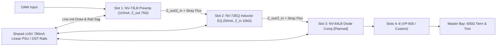

# LBX-500 & Vintage 500-Series Virtual Analog Suite

**C++20 / JUCE 8** circuit-modeled audio plugins (**VST3**, **macOS Audio Unit**, and **Standalone**) built around a native **6-Slot VPR 500-Series Lunchbox Container (`LBX-500`)** with a sample-accurate **electrical and magnetic backplane**.

Every analog hardware circuit in this repository compiles **two ways from the same Grey-Box DSP core**:
1. As its own **standalone horizontal console plugin** (`VST3` / `AU` / `Standalone`).
2. As a **vertical `1.5" × 5.25"` 500-series module** (`sdk500::Module500`) that snaps into any of the 6 bays of **`LBX-500 Lunchbox`**, drawing live `mA` current from a shared `±16V DC` power supply, loading the previous slot's output transformer impedance (`Z_out -> Z_in`), and radiating signed stray magnetic flux into neighboring slots.

---

## Why This Sounds Like Hardware: Schematic-Faithful Grey-Box DSP

Rather than approximating vintage gear with static digital biquads and generic `tanh()` clippers, each module models the specific physical non-idealities found on the original factory circuit drawings (all running at **`4x` oversampling** via cascaded 17th-order Cauer elliptic polyphase half-band filters with `>105 dB` alias rejection):

### 1. The `LBX-500` Electrical & Magnetic Backplane (`Chassis500/` + `SDK500/`)
Real 500-series modules interact electrically when racked together. `ChassisBackplaneDSP` solves three inter-slot interactions per sample across all 6 bays:
- **Shared `±16V DC` (`780 mA`) Linear PSU Sag vs. Isolated `OST` Regulation:** Each active Class-A / inductor module reports its idle + instantaneous dynamic signal current (`mA`). Under heavy multi-slot load (e.g., six 3-stage Class-A preamps pulling `>850 mA`), the **Vintage Linear** supply droops (`±16.00V -> ±14.87V` with subtle `120 Hz` full-wave bridge ripple), organically softening `BA283`/`BA284` transistor headroom. Flipping the PSU switch to **Isolated OST** engages per-slot voltage regulation (`±16.00V` rock-steady).
- **True `Z_out -> Z_in` Inter-Slot Transformer Loading:** Every slot exports dynamic input and output impedances (`1200 Ω` Hi-Z / `300 Ω` Lo-Z / `10 kΩ` bridging / `600 Ω` termination vs. `75 Ω` `LO1166` secondary). Terminating an `LO1166` output transformer into a `600 Ω` load reproduces the exact hardware **`-0.96 dB`** voltage divider drop ($20\log_{10}(600/675) - 20\log_{10}(10000/10075)$) and damps transformer secondary ringing.
- **Adjacent-Slot Stray Magnetic Flux Crosstalk:** Unshielded `T10468`/`LO1166` transformers and `T1295`/`T1280` EQ inductors export signed core flux per sample, inducing inverse-distance (`1 / d^2`) magnetic pickup into neighboring slots.



### 2. `NV-73` / `NV-73LB` Discrete Class-A Mic Preamp (`Neve1073Preamp/`)
Modeled from original `1073` / `1290` preamp schematics (`T10468`, `PL20033`, `BA283AV`, `BA284`, `LO1166`) — see [`docs/NV73_1073_Preamp_Circuit_DSP.md`](docs/NV73_1073_Preamp_Circuit_DSP.md):
- **Implicit Newton-Raphson Marinair Transformer Flux (`T10468` & Gapped `LO1166`):** Solves $\frac{d\Phi}{dt} = \omega_c(v_{\text{in}} - i_m(\Phi))$ per sample so magnetic flux scales physically as $\Phi \propto V/f$ — saturating bass fundamentals richly (`H2 = -23.9 dBc` at `55 Hz` vs. `-34.5 dBc` at `1 kHz`) while keeping highs silky, plus modeling the `+0.55 dB` `~38 Hz` primary head-bump and `~20 kHz` Zobel-damped secondary air resonance.
- **Hardware `50 dB -> 55 dB` Multi-Deck Switch Rewiring (`PL20033`):** `Line` and `20–50 dB` run a **2-stage** circuit (`BA283NV` -> `BA283AM`); clicking from `50 dB` to `55 dB` physically inserts a **3rd discrete `BC184C` triple (`BA284`)** in cascade and shifts per-stage negative feedback loop margin across all 14 stepped positions (`±0.03 dB` accuracy).
- **Single-Ended `2N3055` Class-A Load Line & Tantalum Sag (`BA283AM`):** Models the `~60 mA` DC-biased `2N3055` collector load line (dominant `2nd`-harmonic warmth, `H2 = -27.9 dBc` over `H3 = -43.7 dBc` prior to clipping), `RV1` bias symmetry trimpot, and `10 µF` / `100 µF` tantalum coupling-capacitor bias shift (`~2.2 ms` attack / `~65 ms` recovery).

### 3. `NV-73EQ` (`1073LBEQ`) 3-Band Tapped-Inductor EQ & HPF (`Neve1073EQ/`)
Modeled from sub-assemblies `B205`, `B211`, `BA182C`, and dual `BA284` Class-A triples — see [`docs/NV73EQ_1073LBEQ_Inductor_EQ_DSP.md`](docs/NV73EQ_1073LBEQ_Inductor_EQ_DSP.md):
- **`B205` Active Baxandall Shelves + `BA284` Amp 1:** Smooth `12 kHz` HF air shelf (`±16 dB`) and stepped `OFF / 35 / 60 / 110 / 220 Hz` polystyrene LF shelf (`±16 dB`) whose boost demand dynamically reduces closed-loop `BA284` feedback margin.
- **`B211` `T1295` & `T1280` 6-Tap Nonlinear Inductor Mid Bell (`±18 dB`):** Models all 6 physical choke taps (`360, 700, 1.6k, 3.2k, 4.8k, 7.2k Hz`) with authentic proportional-Q tightening (`Q = 1.16` @ `+4 dB` -> `Q = 2.27` @ `+18 dB`) and sample-rate-invariant ZDF magnetic core reluctance saturation that softly compresses harsh resonant transients on hot hits (`>3.4 dB` dynamic peak taming on the `T1295` iron-core tap).
- **`BA182C` `5.1 kΩ`-Terminated Passive `18 dB/Octave` Inductor HPF:** Stepped `OFF / 50 / 80 / 160 / 300 Hz` `C-L-C` filter operating independently of the `EQL` switch and reproducing the signature **`+0.5 .. +0.7 dB` resonant passband punch bump** just above cutoff.

---

## Project Status: What's Done So Far

| Module / Subproject | Standalone Plugin (`VST3` / `AU` / `App`) | `LBX-500` Vertical Strip | Idle Draw (`±16V`) | Automated Circuit `CTest` | Status |
| :--- | :--- | :--- | :--- | :--- | :--- |
| **`SDK500` Electrical Bus** | Header Framework (`SDK500/`) | Includes **`VP-600`** Bridged-T Pad & `600Ω` Load | `0 mA` (Passive) | `LBX500BackplaneTests` | **Complete & Verified** |
| **`LBX-500 Lunchbox`** | `LBX-500 Lunchbox` (6-Slot Rack + PSU Bay) | Host Chassis (Drag-and-Drop, `BYP`, `SOLO`, `OST`/Linear PSU) | `780 mA` Budget | `LBX500BackplaneTests` (`100%` Pass) | **Complete & Verified** |
| **`NV-73` Mic Preamp** | `NV-73 Mic Preamp` | `NV-73LB` (`1200Ω`/`300Ω` in, `75Ω` out) | `110 mA` (+42 mA dyn) | `Neve1073DspTests` (`100%` Pass) | **Complete & Verified** |
| **`NV-73EQ` (`1073LBEQ`)** | `NV-73EQ Inductor EQ` (with Live Response Analyzer) | `NV-73EQ` (with Mini Live EQ Curve & Glow Lamp) | `50 mA` (+18 mA dyn) | `Neve1073EQDspTests` (`100%` Pass) | **Complete & Verified** |
| **`NV-64LB` (`2264ALB`)** | `NV-2264A Diode Limiter` | `NV-64LB` (PPM GR Meter + Slow Attack `SA`) | `85 mA` (+22 mA dyn) | `Compressor2264Tests` *(Planned)* | **Up Next — Spec Ready** |

---

## Roadmap: `NV-64LB` (`2264ALB` Diode-Bridge Limiter/Compressor)

Full circuit breakdown and implementation specification: **[`docs/ROADMAP_NV64LB_2264ALB_Compressor.md`](docs/ROADMAP_NV64LB_2264ALB_Compressor.md)**

1. **Three-Transformer + `-40 dB` Padded `BA185` 4-Diode Bridge Core:**
   - Models input transformer `T1` (`TF10002`) -> `-40 dB` resistive bridge pad -> DC-biased 4-diode lattice ($r_d = \frac{2\eta V_T}{I_0 + I_{\text{ctrl}}}$) with GR-dependent `H2`/`H3` harmonic thickening -> interstage transformer `T2` -> discrete Class-A `BA283` makeup stage (`0 .. +20 dB`) -> gapped `LO1166` output transformer `T3`.
   - Supports both hard-wire **`BYP`** and classic **"3-Transformer Box-Tone Mode"** (`COMP OFF` + `LIM OFF`, keeping all three transformers + idle diode bridge + `BA283` active in the path).
2. **Independent `BA191` Compressor & `BA192` Peak Limiter Feedback Sidechains:**
   - Closed-loop feedback sidechain tap ($K_{\text{fb}} = R - 1$, $\tau_{\text{open,atk}} = R \cdot \tau_{\text{spec,atk}}$) for exact hardware ratios (`1.5:1, 2:1, 3:1, 4:1, 6:1` Compressor + `20:1` Peak Limiter), switchable **`Slow Attack (SA)`** (`3 ms` vs. `10 ms` bus-glue attack), and stacked dual-capacitor **Auto-Recovery (`a1`: `100ms / 2s`, `a2`: `50ms / 5s`)**.
3. **Complete 3-Slot Lunchbox Channel Strip Integration:**
   - Register `nv64lb` in [`SDK500/Include/sdk500/ModuleRegistry.h`](SDK500/Include/sdk500/ModuleRegistry.h) so `Slot 1 (NV-73LB) -> Slot 2 (NV-73EQ) -> Slot 3 (NV-64LB)` runs as a unified `~255 mA` 3-slot analog channel strip inside **`LBX-500 Lunchbox`**.

---

## Repository Structure

```text
lunchbox/
├── CMakeLists.txt                  # Top-level C++20 / JUCE 8.0.4 monorepo build
├── SDK500/                         # VPR 500-Series electrical backplane bus, ModuleRegistry & VP-600 pad
├── Chassis500/                     # LBX-500 6-Slot Lunchbox container plugin + backplane verification tests
├── Neve1073Preamp/                 # NV-73 standalone preamp + NV-73LB 500-series module + circuit tests
├── Neve1073EQ/                     # NV-73EQ (1073LBEQ) inductor EQ + 500-series module + circuit tests
├── docs/                           # Detailed schematics, equations & NV-64LB (2264ALB) engineering plan
└── .github/workflows/ci.yml        # Automated macOS CMake build & CTest verification pipeline
```

---

## Building, Testing & Installing (macOS)

### Prerequisites
- macOS (`arm64` or `x86_64`) with Xcode Command Line Tools (`AppleClang` C++20)
- `CMake >= 3.22` (JUCE `8.0.4` is fetched automatically on first configure if not cached locally)

### Configure, Build & Run Circuit Verification Suites
```bash
cmake -S . -B build -DCMAKE_BUILD_TYPE=Release
cmake --build build --config Release -j8
ctest --test-dir build --output-on-failure -V
```

### Install `VST3` & `AU` Bundles into macOS Plugin Library
```bash
# VST3
rsync -a --delete "build/Chassis500/LBX500Chassis_artefacts/Release/VST3/LBX-500 Lunchbox.vst3/" "$HOME/Library/Audio/Plug-Ins/VST3/LBX-500 Lunchbox.vst3/"
rsync -a --delete "build/Neve1073Preamp/Neve1073Preamp_artefacts/Release/VST3/NV-73 Mic Preamp.vst3/" "$HOME/Library/Audio/Plug-Ins/VST3/NV-73 Mic Preamp.vst3/"
rsync -a --delete "build/Neve1073EQ/Neve1073EQ_artefacts/Release/VST3/NV-73EQ Inductor EQ.vst3/" "$HOME/Library/Audio/Plug-Ins/VST3/NV-73EQ Inductor EQ.vst3/"

# Audio Units (.component)
rsync -a --delete "build/Chassis500/LBX500Chassis_artefacts/Release/AU/LBX-500 Lunchbox.component/" "$HOME/Library/Audio/Plug-Ins/Components/LBX-500 Lunchbox.component/"
rsync -a --delete "build/Neve1073Preamp/Neve1073Preamp_artefacts/Release/AU/NV-73 Mic Preamp.component/" "$HOME/Library/Audio/Plug-Ins/Components/NV-73 Mic Preamp.component/"
rsync -a --delete "build/Neve1073EQ/Neve1073EQ_artefacts/Release/AU/NV-73EQ Inductor EQ.component/" "$HOME/Library/Audio/Plug-Ins/Components/NV-73EQ Inductor EQ.component/"
```

---

## Disclaimer
*All historical circuit numbers, sub-assembly references (`1073`, `1073LBEQ`, `2264ALB`, `BA283`, `BA284`, `B205`, `B211`, `BA182C`, `T10468`, `LO1166`, `VPR`), and manufacturer names are referenced strictly for educational and circuit-modeling documentation purposes. This project is an independent Virtual Analog DSP research project and is not affiliated with, endorsed by, or sponsored by AMS Neve Ltd., Marinair, or API.*
