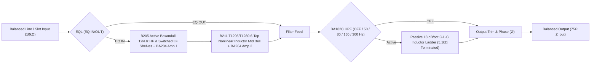

# `NV-73EQ` (`1073LBEQ`) 3-Band Inductor EQ & HPF — Circuit Schematic & Grey-Box DSP Specification

This document details the discrete analog equalizer and passive inductor filter circuitry modeled in [`Neve1073EQ/Source/DSP/`](../Neve1073EQ/Source/DSP/): sub-assemblies **`B205`** (`D10042`), **`B211`** (`D10048`), **`BA182C`**, and dual **`BA284`** Class-A amplifier triples.

---

## 1. Hardware Signal Path

> [!NOTE]
> Just like physical `1073` / `1073LBEQ` hardware, the **`BA182C` `18 dB/oct` High-Pass Filter** sits outside the `EQL` (`EQ IN`) bypass switch so engineers can keep rumble filtering engaged while A/B-comparing the 3-band EQ.

---

## 2. Sub-Circuit Models

### A. `B205` Active Baxandall Shelving Network + `BA284` Amp 1 (`B205BaxandallShelves.h`)
- **High Shelf (`HF`):** Fixed `"12 kHz"` RC feedback shelf (`±16 dB`, `Q = 0.56`) whose broad Baxandall turnover begins gently in the upper midrange (`7.8 kHz` half-dB inflection, reaching plateau across `12–18 kHz`).
- **Low Shelf (`LF`):** Stepped **`OFF / 35 / 60 / 110 / 220 Hz`** polystyrene capacitor shelf (`±16 dB`, `Q = 0.66`).
- **Feedback-Loop Interaction:** Boosting either shelf increases closed-loop gain demand inside `BA284` Amp 1 (`3x BC184C`), shrinking NFB loop margin and adding subtle even-order Class-A sheen proportional to boost depth.

### B. `B211` Multi-Tapped Nonlinear Inductor Midrange Bell (`B211InductorMidBell.h`)
Models both physical multi-tapped chokes (`T1295` / `VTB9043` iron-core low-mid choke and `T1280` / `VTB9044` presence choke):

| Step | Center $f_0$ | Hardware Choke Tap | Approx. $L / C$ | Core Saturation Character |
| :--- | :--- | :--- | :--- | :--- |
| **`OFF`** | — | Tank open | — | Pure `BA284` Class-A pass-through |
| **`0.36`** | `360 Hz` | `T1295` high-inductance tap | `~3.0 H` / `65 nF` | Warmest iron-core saturation (`>3 dB` hot peak taming) |
| **`0.7`** | `700 Hz` | `T1295` mid tap | `~1.3 H` / `39 nF` | Thick low-mid chest & snare body |
| **`1.6`** | `1.6 kHz` | `T1280` `200 mH` full coil | `200 mH` / `49 nF` | Classic vocal & guitar forwardness |
| **`3.2`** | `3.2 kHz` | `T1280` `160 mH` tap | `160 mH` / `15.5 nF` | Articulate presence bite without digital glare |
| **`4.8`** | `4.8 kHz` | `T1280` `100 mH` tap | `100 mH` / `11 nF` | Consonants & acoustic string definition |
| **`7.2`** | `7.2 kHz` | `T1280` `~68 mH` tap | `68 mH` / `7.2 nF` | Silky upper-presence sheen below the `12 kHz` shelf |

- **Proportional-Q Tightening:** Effective $Q$ narrows organically from `~0.75` at small `±2 dB` nudges up to `~2.27` at `±18 dB`.
- **Sample-Rate-Invariant ZDF Core Reluctance Saturation:** High instantaneous coil current $i_L$ inside a boosted band dynamically increases trapezoidal ZDF tank core loss $k_{\text{eff}}(i_L) = k_0(1 + \alpha_{\text{core}} i_L^2)$ and compresses magnetic tap voltage — remaining `<0.05 dB` linear at small signals while smoothly taming harsh resonant transients on hot hits and exporting stray choke flux to adjacent `LBX-500` slots.

### C. `BA182C` `5.1 kΩ`-Terminated `18 dB/Octave` Inductor HPF (`BA182InductorHPF.h`)
- Cascades a `1st-order` TPT polystyrene capacitor pole (`0.85 * f_c`) with an underdamped `2nd-order` ZDF shunt-inductor `LC` stage (`1.155 * f_c`, `Q = 1.08`), reproducing **exact `-3 dB` at `f_c`**, steep `~19.6 dB/octave` sub-bass roll-off, AND the signature **`+0.5 .. +0.7 dB` resonant passband "punch bump"** just above cutoff (`~1.45 * f_c`).
