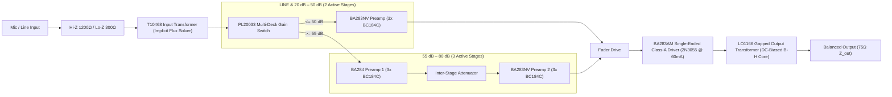

# `NV-73` / `NV-73LB` Mic Preamp — Circuit Schematic & Grey-Box DSP Specification

This document details how the discrete Class-A microphone preamplifier circuit (inspired by vintage drawing `EH10023` / `E10006`: `T10468`, `PL20033`, `BA283AV`, `BA284`, `LO1166`) is modeled down to sub-circuit physics in [`Neve1073Preamp/Source/DSP/`](../Neve1073Preamp/Source/DSP/).

---

## 1. Signal Flow & The `50 dB -> 55 dB` Hardware Topology Transition

Unlike modern IC preamps that vary a single feedback resistor with a continuous potentiometer, the hardware uses a **3-deck rotary gain switch (`PL20033`)** in **5 dB steps** that physically rewires the active amplifier topology between `+50 dB` and `+55 dB`:

- **`Line` & `+20 dB .. +50 dB` (2-Stage Topology):** Signal routes through `T10468` -> single `BA283NV` 3-transistor (`BC184C`) feedback triple -> Fader/Insert -> `BA283AM` (`2N3055` single-ended Class-A power driver) -> `LO1166` gapped output transformer. At `+50 dB`, `BA283NV` operates near minimal negative feedback margin (maximum 2-stage harmonic push).
- **`+55 dB .. +80 dB` (3-Stage Topology):** Clicking from `50 dB` to `55 dB` switches an **entire additional 3-transistor `BC184C` amplifier (`BA284`)** into series cascade ahead of `BA283NV`, resets inter-stage loop-gain distribution, and lowers reflected input impedance (`~1200 Ω -> ~910 Ω`).

---

## 2. Grey-Box Virtual Analog Models

### A. Implicit Newton-Raphson Transformer Core Flux (`TransformerModel.h`)
Both `T10468` (permalloy input core) and `LO1166` (gapped steel output core carrying `~60 mA` continuous `2N3055` Class-A collector bias) solve Faraday's law per oversampled step (`192 kHz`):
$$\frac{d\Phi}{dt} = \omega_c \left(v_{\text{in}} - i_m(\Phi)\right), \qquad i_m(\Phi) = (\Phi + \Phi_{\text{DC}}) + c_{\text{sat}}(\Phi + \Phi_{\text{DC}})^3 - i_0$$
- **Frequency-dependent saturation ($\Phi \propto V/f$):** `55 Hz` bass notes drive core flux `~18x` harder than `1 kHz` midrange (`H2 = -23.9 dBc` at `55 Hz` vs `-34.5 dBc` at `1 kHz` in `Neve1073DspTests`).
- **DC-Biased Asymmetry ($\Phi_{\text{DC}} > 0$):** Standing `60 mA` Class-A current offsets the `LO1166` core along its B-H curve, producing sweet 2nd-order (`H2`) even harmonics well below hard clipping.
- **LC Head-Bump & Secondary Zobel Resonance:** Zero-Delay Feedback (ZDF) SVF sections model the `+0.55 dB` `~38 Hz` primary coupling-cap resonance and damped `~20 kHz` secondary leakage-inductance air lift.

### B. Single-Ended Class-A `BC184C` & `2N3055` Stages (`BA283Stage.h`)
- **Exact-Unity-Slope Asymmetric Load Line:** Models positive collector current starvation (`R13 = 5.1 kΩ` / `LO1166` primary) vs. negative emitter saturation via $G(x) = R \cosh^2(u_0)[\tanh(x/R + u_0) - \tanh(u_0)]$, modulated by `RV1` bias symmetry trim and `+24V / ±16V` PSU rail sag from the `LBX-500` backplane.
- **Closed-Loop NFB Linearization & Miller Bandwidth:** Loop-gain margin ($A_{\text{OL}} - A_{\text{CL}}$) dynamically adjusts both harmonic suppression and closed-loop `C9/C11` polystyrene Miller HF pole bandwidth across every `5 dB` `PL20033` switch step.
- **Tantalum Coupling-Cap Envelope Sag (`C8 = 10 µF`, `C5 = 100 µF`):** Asymmetric peaks charge the interstage coupling capacitor (`~2.2 ms` attack / `~65 ms` recovery), creating subtle transient compression and Class-A bloom.
