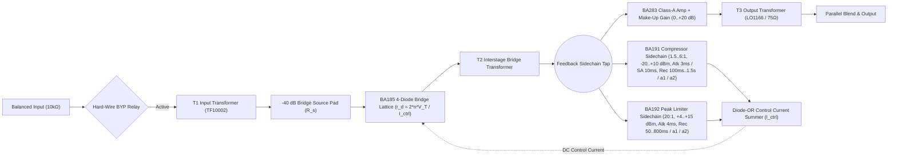

# Next Module Plan: `NV-64LB` (`Neve 2264ALB` Diode-Bridge Limiter/Compressor)

Completing `NV-64LB` gives the **`LBX-500 Lunchbox`** a complete, electrically coupled **3-Slot Vintage British Channel Strip**:
`Slot 1: NV-73LB Mic Preamp (110 mA)` -> `Slot 2: NV-73EQ Inductor EQ (50 mA)` -> `Slot 3: NV-64LB Diode-Bridge Limiter/Compressor (85 mA)`.

---

## 1. Analog Circuit Architecture to Model (`2264A` / `2264ALB`)

Unlike VCA, FET, or optical compressors, the `2264A` / `2264ALB` (descended from the 1969 `2254`) uses a **DC-biased 4-diode bridge variable-impedance shunt attenuator (`BA185`)** surrounded by **three Marinair/St. Ives transformers** and a discrete **single-ended Class-A `BA283` makeup amplifier**.

### Why the `2264ALB` Sounds Distinct (Key Physical Targets)
1. **`-40 dB` Bridge Pad & Thermal-Voltage Curvature (`BA185`):**
   Silicon diodes distort heavily above `~25–40 mV` ($V_T \approx 26\text{ mV}$). Hardware pads the signal down by `~40 dB` across the bridge and recovers `+40 dB` afterward via `T2` + `BA283`. As DC control current $I_{\text{ctrl}}$ rises under heavy Gain Reduction, dynamic diode resistance $r_d = \frac{2\eta V_T}{I_0 + I_{\text{ctrl}}}$ drops and slight diode-quad $V_f$ mismatch (`~1.4%`) blooms smoothly with **GR-proportional `H2` + `H3` harmonic density**.
2. **"3-Transformer Box-Tone Mode" (`COMP OFF` + `LIM OFF` vs. `BYP`):**
   Disengaging `COMP IN` and `LIM IN` while leaving hard-wire `BYP` off still passes audio through **`T1` -> idle-biased `BA185` -> `T2` -> Class-A `BA283` -> `T3` (`LO1166`)**, reproducing the classic studio trick of patching through an idle `2254`/`2264` purely for three-transformer iron weight.
3. **Closed-Loop Feedback Sidechain Law (`BA191` & `BA192`):**
   Tapping the sidechain *after* the diode bridge + `T2` (and *before* the `0..+20 dB` Make-Up Gain control) yields exact terminal ratio $R = 1 + K_{\text{fb}} \implies K_{\text{fb}} = R - 1$, while scaling open-loop rectifier charging resistance $\tau_{\text{open,atk}} = R \cdot \tau_{\text{spec,atk}}$ preserves exact closed-loop hardware attack times (`3.0 ms` Normal, `10.0 ms` **`SA` Slow Attack**, and `4.0 ms` Limiter) with unconditional 1-sample feedback stability at `192 kHz` (`4x` Cauer oversampling).
4. **Dual-Tantalum-Capacitor Program-Dependent Auto-Recovery (`a1` & `a2`):**
   Stacked fast/slow capacitor network (`v_fast` coupled to reservoir `v_slow`):
   - **`a1`:** `100 ms` fast transient release / `2.0 s` sustained program release.
   - **`a2`:** `50 ms` fast peak recovery / `5.0 s` smooth swell recovery.

---

## 2. Planned Implementation Milestones (`Neve2264Compressor/`)

| Step | File / Target | Description |
| :--- | :--- | :--- |
| **1. Diode Bridge DSP** | `Neve2264Compressor/Source/DSP/DiodeBridgeBA185.h` | Matched 4-diode shunt attenuator with `GR`-dependent `tanh` thermal curvature + `1.4%` quad asymmetry (`H2`) + DC feedthrough blocking. |
| **2. Dual Feedback Sidechains** | `Neve2264Compressor/Source/DSP/SidechainBA191_192.h` | Independent `BA191` Compressor (`1.5:1, 2:1, 3:1, 4:1, 6:1`, `-20..+10 dBm`, `3 ms / 10 ms SA`, `100/400/800/1500 ms / a1 / a2`) + `BA192` Limiter (`20:1`, `+4..+15 dBm`, `4 ms` atk, `50/100/200/800 ms / a1 / a2`) + optional `SC HPF (OFF / 60 / 120 Hz)`. |
| **3. 3-Transformer Engine** | `Neve2264Compressor/Source/DSP/Neve2264DSP.h` | Reuses `TransformerModel` (`T1`, `T2`, `T3 LO1166`), `BA283Stage` (`OutputAM` + `0..+20 dB` make-up), `Oversampler` (`4x` Cauer), stereo sidechain link, parallel Dry/Wet mix, and `LBX-500` `processFrameBackplane(...)` (`85 mA` idle + `22 mA` dynamic draw). |
| **4. 500-Series Module & Standalone UI** | `Source/Module500/NV2264Module500.h`, `PluginProcessor.*`, `PluginEditor.*` | Vertical `NV-64LB` Lunchbox faceplate with live PPM `0..20 dB` Gain Reduction bar + horizontal `NV-2264A` console UI with interactive Compressor+Limiter transfer knee plot & PPM GR meter; register `"nv64lb"` in `SDK500/Include/sdk500/ModuleRegistry.h`. |
| **5. Automated Circuit Test Bench** | `Neve2264Compressor/Tests/Compressor2264Test.cpp` | Verify `BYP` vs 3-transformer box-tone harmonics, all 5 compressor ratios, `3 ms` vs `10 ms` `SA` transient peak retention, `a2` transient-vs-swell auto-recovery ratio, `20:1` limiter ceiling, and 3-slot (`NV-73LB -> NV-73EQ -> NV-64LB`) Lunchbox bus load (`~255 mA`). |
